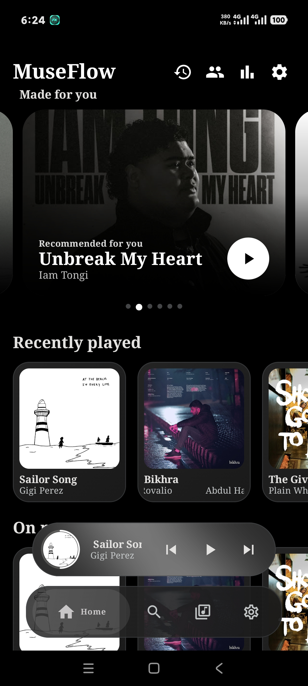
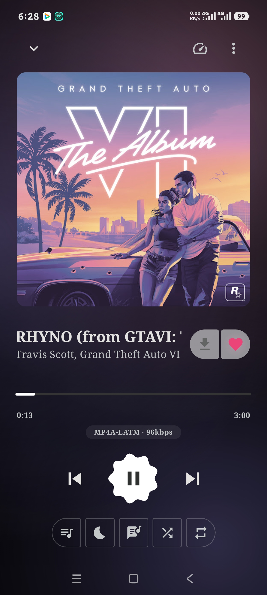
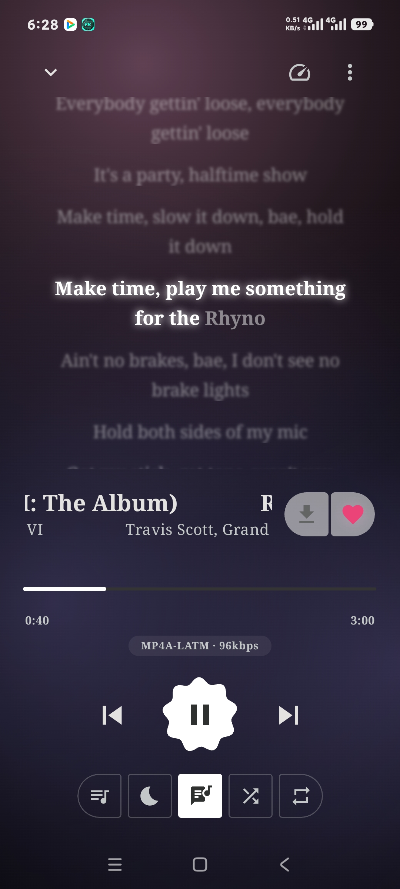
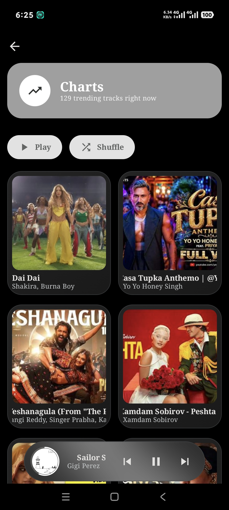
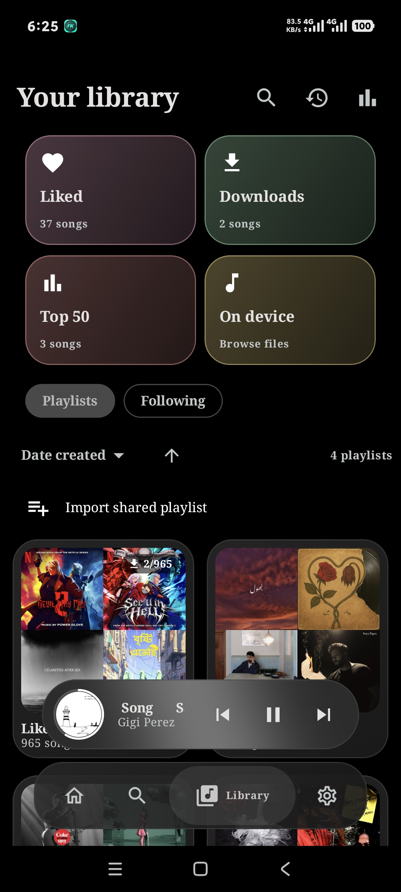

<div align="center">


<h1>MuseFlow</h1>

<p><strong>Music that moves with you.</strong></p>

<p>A free, ad-free Android music player for streaming, offline listening, and the songs on your device.</p>

<p>
  
  
  
  
  
</p>

<p>
  <a href="https://github.com/Panduu3163/Muse_Flow/releases"><strong>Browse releases</strong></a>
  &nbsp; · &nbsp;
  <a href="#screenshots"><strong>Screenshots</strong></a>
  &nbsp; · &nbsp;
  <a href="CHANGELOG.md"><strong>Changelog</strong></a>
  &nbsp; · &nbsp;
  <a href="#feedback"><strong>Feedback</strong></a>
</p>

</div>

---

## 🎵 Overview

MuseFlow brings online music, offline downloads, local files, synchronized lyrics, and a customizable player into one Android app. Browse your library, discover something new, or shape the look of your listening experience with artwork colours, animated backgrounds, fonts, and player styles.

Built with **Kotlin, Jetpack Compose, Material 3, and Media3**, MuseFlow focuses on responsive controls, readable screens, and a listening experience that feels personal.

> [!NOTE]
> MuseFlow is an independently developed **beta**. Version **1.7.0** brings together the latest interface, playback, lyrics, and discovery improvements. Published APKs are listed on the [Releases page](https://github.com/Panduu3163/Muse_Flow/releases).

## Contents

- [Screenshots](#screenshots)
- [What's new in 1.7.0](#whats-new-in-170)
- [Features](#features)
- [Installation and setup](#installation-and-setup)
- [How it works](#how-it-works)
- [Feedback](#feedback)
- [Credits](#credits)
- [License](#license)
- [Developer](#developer)

---

<a id="screenshots"></a>

## 📱 Screenshots

<table>
  <tr>
    <td align="center"><strong>Home</strong><br><br></td>
    <td align="center"><strong>Now Playing</strong><br><br></td>
    <td align="center"><strong>Player styles</strong><br><br></td>
  </tr>
  <tr>
    <td align="center"><strong>Lyrics</strong><br><br></td>
    <td align="center"><strong>MuseChart</strong><br><br></td>
    <td align="center"><strong>Library</strong><br><br></td>
  </tr>
</table>

---

<a id="whats-new-in-170"></a>

## ✨ What's new in 1.7.0

- **A more polished interface** — Refined browsing screens, frosted bottom navigation, clearer action sheets, and consistent press, selection, and icon animations.
- **Smoother track changes** — Next-track audio preloading, adjacent cover-art warming, and artwork transitions that avoid disruptive full-cover loading flashes.
- **More reliable playback** — Improved player startup, restored queues, offline local-file playback, and visible Retry feedback when a stream fails.
- **Discovery that learns from listening** — Local preference learning uses listening and deliberate skips to help rank recommendations and radio continuations.
- **Music-focused Home discovery** — Home and artist-based radio fallback use the music catalog, while explicit Search still supports general YouTube uploads.
- **Recording-aware library state** — Different audio, video, live, and alternate recordings keep their own playback, Like, and Download identity.
- **Library and Search refinement** — More consistent sorting and view preferences, smoother section changes, and fixes for overlapping lists and stale search results.
- **Lyrics and performance improvements** — Better Lyrics matching and fallback refinements, native lyric rendering, fewer unnecessary background updates, and reduced-motion support.

Read the [full changelog](CHANGELOG.md) for the release history.

---

<a id="features"></a>

## 🎧 Features

<details open>
<summary><strong>▶️ Streaming and playback</strong></summary>

- Stream online music and play downloaded or On-device audio from the same app.
- Background playback with media notifications, lock-screen controls, and a notification Like action.
- Next-track audio preloading to reduce waiting between songs when enough data can be prepared in advance.
- Play/Pause controls that remain usable while a stream is buffering.
- Optional codec and bitrate information for the active stream or file.
- Sleep timer with a smooth 15-minute-step slider up to two hours and a custom hours/minutes picker.
- Seven-band equalizer, volume normalization, silence skipping, crossfade, bass boost, and headphone crossfeed.

</details>

<details>
<summary><strong>📚 Library, downloads, and queues</strong></summary>

- Liked Songs, Downloads, Top 50, Recently Played, local files, personal playlists, and followed artists.
- Source-aware queues capped at **51 tracks**, with suitable recommendations extending short online collections when available.
- Offline Downloads queues stay with playable downloaded music; On-device queues stay local.
- A single queue list with Shuffle, Repeat, Radio, queue count, duration, and an order-editing lock.
- Drag to reorder where permitted, swipe to remove, and Undo to restore a removed song.
- Cover-art playing indicators that remain visible and freeze when playback is paused.
- Independent sorting, direction, filtering, and grid/list choices in supported library sections.
- Playlist creation, sharing, online playlist saving, and CSV/M3U/M3U8 import.
- Backup and restore for liked songs and playlists.

</details>

<details>
<summary><strong>🧭 Search and discovery</strong></summary>

- Search songs, music videos, albums, artists, and playlists, including uploads outside the YouTube Music catalog.
- Home recommendations, Daily Discover, charts, new releases, artist pages, and recent searches.
- Local listening preferences help rank discovery and radio without requiring a pretrained neural model.
- Search playback continues through the recommendation/radio path rather than treating unrelated search results as a playlist.
- On repeat, listening history, and Stats for exploring your songs, artists, and albums.
- Recorded listening time is distinguished from historical estimates.
- Listen Together rooms for synchronized playback with a compatible server.

</details>

<details>
<summary><strong>🎤 Lyrics and sharing</strong></summary>

- Synchronized lyrics with word-by-word highlighting when timing data is available.
- **Nine animation styles:** Fade, Bounce, Scale, Wave, Karaoke sweep, Metro, Fluid (V2), Vivi Music, and Apple Music.
- Active-line following centered within the visible lyrics area, with manual scrolling and a Follow control.
- Text size, alignment, line spacing, inactive-line blur, glow, and optional tap-a-line seeking.
- **Six reorderable sources:** YouLyPlus, PaxSenix, Better Lyrics, SimpMusic, LRCLib, and Kugou.
- Source selection, lyric finding, timing adjustments, and lyric-card sharing from the full-player menu.
- Cached matching lyrics for offline use when previously fetched.
- Share up to **four selected lyric lines** on a card with cover art, track information, MuseFlow branding, colour presets, gradients, artwork glow, or a translucent glass treatment.

Word-timed sources follow their supplied timestamps. Line-timed lyrics use an estimated word pace, and some songs may have no available lyrics.

</details>

<details>
<summary><strong>🎨 Appearance and player customization</strong></summary>

- **Four theme modes:** Follow system, Light, Dark, and AMOLED.
- Album-art colours or a manually chosen accent hue.
- System, Serif, Monospace, and a Nothing-inspired Dot matrix font option, with actual-font previews.
- Visual selectors for display density and card size.
- **Six player backgrounds:** Solid, Album gradient, Blurred artwork, Live mesh, Glow animated, and Apple Music inspired.
- **Four progress styles:** Default, Slim, Wavy, and Squiggly.
- **Three transport styles:** Static, Wheel, and Pill.
- Hide artwork, square crop, adjustable corner radius, rotating artwork, and artwork swipe controls.
- An Apple Music inspired lyrics panel with a readable translucent surface over the artwork backdrop.
- A compact mini-player with progress around its rounded cover art and artwork-based style previews.
- Searchable settings, appearance previews, and controls to reset appearance or player choices.

</details>

<details>
<summary><strong>🫧 Motion, accessibility, and everyday use</strong></summary>

- Consistent press feedback across song rows, cards, settings, and icon controls.
- Animated state changes that keep actions immediate and current accessibility labels clear.
- Bottom navigation that expands the selected tab's name horizontally.
- Support for Android's reduced-motion setting and system font scaling.
- Readable loading/error states and an explicit Retry action for failed playback.
- Restored queues remain paused until you choose to play; reconnecting alone does not press Play.
- Reduced unnecessary UI updates and background work without removing listening features.

</details>

---

<a id="installation-and-setup"></a>

## 📥 Installation and setup

### Install on Android

1. Open [GitHub Releases](https://github.com/Panduu3163/Muse_Flow/releases) and choose a published APK for your device.
2. Allow Android to install the APK from your browser or file manager if prompted.
3. Open MuseFlow. Grant media access when you want to browse songs stored on your device.

MuseFlow supports **Android 7.0 and newer** and is currently distributed as a beta APK.

**Already using MuseFlow Beta?** Install a newer beta APK over the existing beta app using the same app ID and signing certificate. Do not uninstall first if you want to retain the app's local data. The regular APK uses a different Android app ID and installs separately. Keep a library backup before major updates.

In-app updates open Android's installer; they never install silently. Read changelog can retain fetched release notes for offline reading once those notes are available.

<details>
<summary><strong>🛠️ Build from source</strong></summary>

<br>

1. Clone the repository and open it in Android Studio with a compatible JDK and Android SDK.
2. Create the local signing file expected by the build. The key is not included in the repository:

   ```sh
   keytool -genkeypair -keystore debug.keystore -storepass android -alias androiddebugkey -keypass android -keyalg RSA -keysize 2048 -validity 10000 -dname "CN=Android Debug,O=Android,C=US"
   ```

3. Sync Gradle, then build:

   **macOS / Linux**

   ```sh
   ./gradlew assembleDebug
   ```

   **Windows**

   ```powershell
   .\gradlew.bat assembleDebug
   ```

   To build the beta variant, use `assembleBeta` instead.

A newly generated local key cannot update an installed APK signed with MuseFlow's existing beta certificate. Android requires the same app ID and signing certificate for an in-place update.

</details>

---

<a id="how-it-works"></a>

## ⚙️ How it works

| Area | Technology |
| --- | --- |
| Interface | Kotlin, Jetpack Compose, Material 3 |
| Playback | Media3 / ExoPlayer and Android media sessions |
| State and storage | Coroutines, Flow, Room, DataStore |
| Networking and artwork | OkHttp, Retrofit, Coil |
| Discovery | Music-provider results and local listening-preference ranking |
| Lyrics | Separate lyric providers, caching, and native Compose rendering |

MuseFlow does not host audio or provide an official YouTube service. Online search and playback use the included `:innertube` module, YouTube Music and YouTube client integrations, and [NewPipeExtractor](https://github.com/TeamNewPipe/NewPipeExtractor) where stream extraction and signatures need resolving. On-device files play through Android's media library, and lyrics are fetched separately from audio.

Online integrations are unofficial. Track availability, lyric coverage, and playback can vary by region, provider, connection, and changes to upstream services. Preloading helps prepared tracks start sooner, but a cold skip or slow connection can still require buffering.

---

<a id="feedback"></a>

## 💬 Feedback

MuseFlow is a personal project that is actively maintained. If something goes wrong, a clear report helps reproduce it.

Include:

- Your MuseFlow version, phone model, and Android version.
- The steps that caused the problem, what you expected, and what happened instead.
- Whether you were online or offline, and whether the track came from Search, Downloads, On device, or another section.
- The exact recording/version and relevant player or lyrics settings, when applicable.
- A short recording, screenshot, or an in-app crash report if available.

[Open an issue](https://github.com/Panduu3163/Muse_Flow/issues) or email [mynulkbr@gmail.com](mailto:mynulkbr@gmail.com).

---

<a id="credits"></a>

## 🤝 Credits

MuseFlow benefits from work and ideas shared by the open-source music community:

- [Metrolist](https://github.com/MetrolistGroup/Metrolist) and [SimpMusic](https://github.com/maxrave-dev/SimpMusic) for YouTube Music integration research and implementation references.
- [NewPipeExtractor](https://github.com/TeamNewPipe/NewPipeExtractor) and [zemer-cipher](https://github.com/ZemerTeam/zemer-cipher) for stream and cipher work.
- [Echo Music](https://github.com/EchoMusicApp/Echo-Music) for player, lyrics, customization, and Listen Together references.
- The maintainers of **YouLyPlus, PaxSenix, Better Lyrics, SimpMusic, LRCLib, and Kugou** for lyric sources.
- The maintainers of AndroidX, Jetpack Compose, Media3, and the other libraries used throughout the app.

See the source and bundled license notices for component attribution, adapted code, and license details.

---

<a id="license"></a>

## 📄 License

MuseFlow is licensed under [GPL-3.0](LICENSE). Dependencies and adapted components retain their respective license notices.

<a id="developer"></a>

## 👨‍💻 Developer

**Mynul Kabir Nayem**

[mynulkbr@gmail.com](mailto:mynulkbr@gmail.com)

<div align="center">

<p><strong>Made with care for the music and the people listening.</strong></p>

<p>If MuseFlow is useful to you, consider leaving a star on the repository. ⭐</p>

</div>
